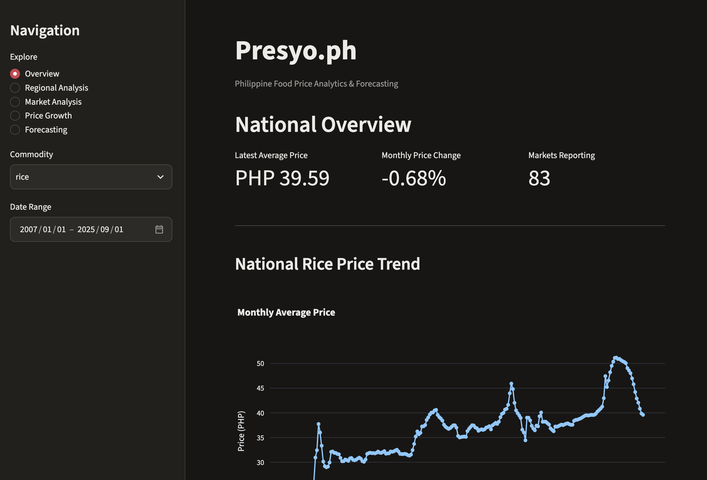
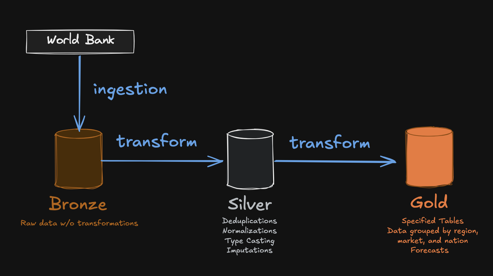
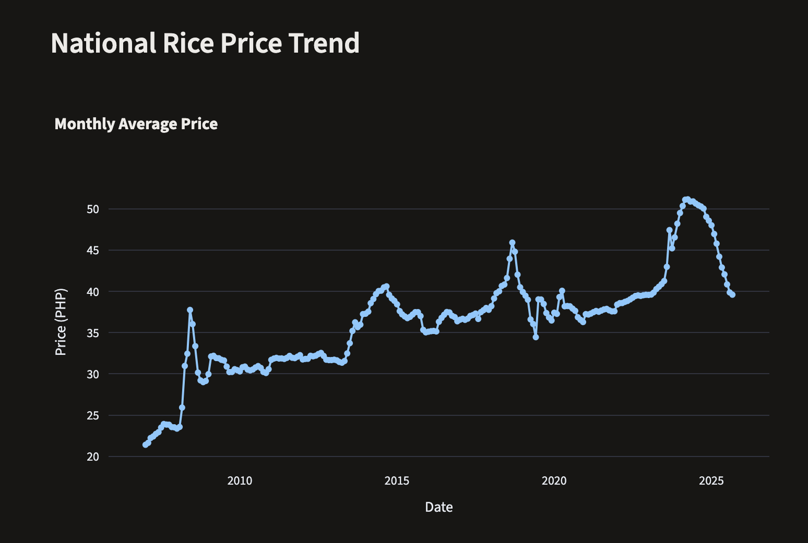
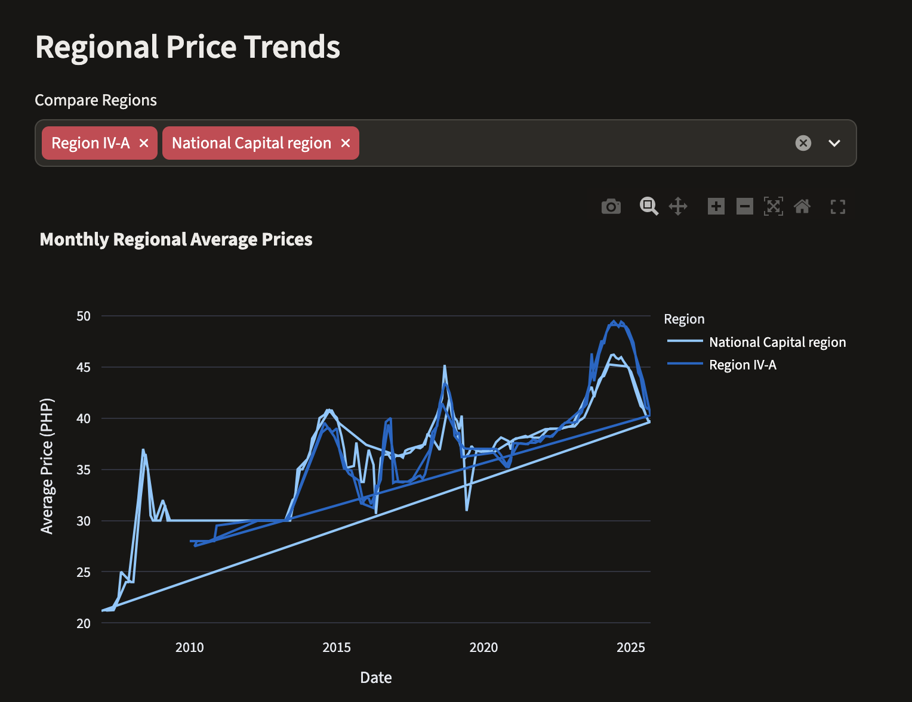
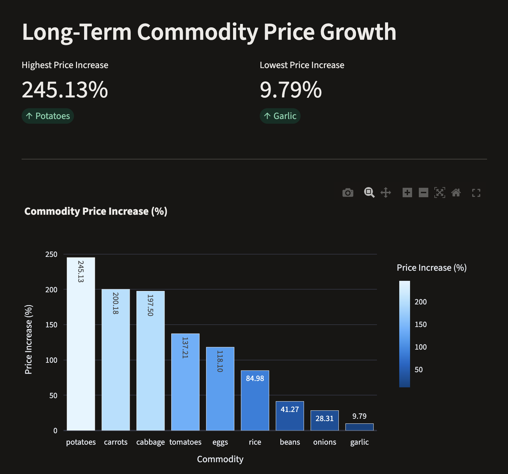
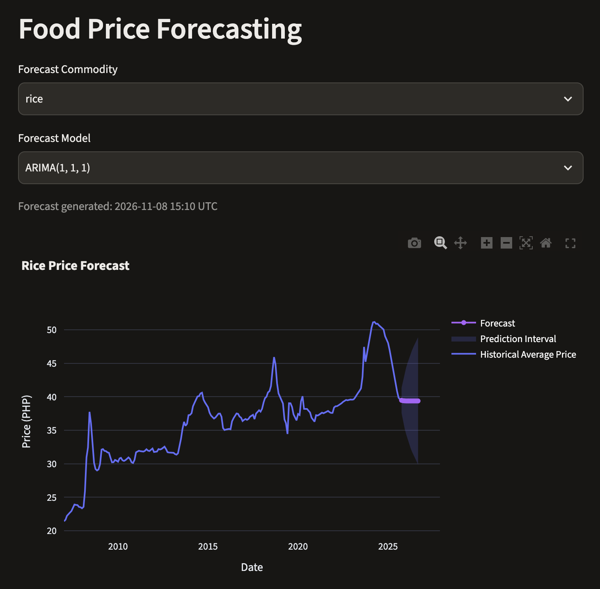

# Presyo-PH: Philippine Food Price Analytics & Forecasting

An end-to-end data engineering, data science, and analytics project exploring historical food price trends across Philippine markets using World Bank data.

Presyo-PH transforms raw food price observations into structured analytical datasets and uses statistical time-series forecasting to explore future commodity price movements.



## Project Overview

Food prices are an important part of understanding household purchasing power and market conditions. However, historical price observations need to be collected, cleaned, transformed, and analyzed before they can provide useful insights.

Presyo-PH addresses this by building a reproducible data pipeline that processes Philippine food price data and produces analytical datasets for visualization and forecasting.

### Project Objectives

- Build an end-to-end data pipeline using a Medallion Architecture.
- Process and transform historical food price observations using PySpark.
- Develop analytical datasets for national and regional price analysis.
- Explore historical price growth, volatility, and seasonal patterns.
- Implement an introductory time-series forecasting workflow for rice prices.
- Support reproducible execution in local and Databricks environments.

## Data Source

**Source:** [World Bank Microdata – Monthly Food Price Estimates by Product and Market](https://microdata.worldbank.org/catalog/6172)
Andrée, B. P. J. (2021). Monthly food price estimates by product and market (Version 2025-11-24). PHL_2021_RTFP_v02_M. Washington, DC: World Bank Microdata Library. https://doi.org/10.48529/2ZH0-JF55

The project uses the Philippine subset of the dataset.

| Attribute | Description |
|---|---|
| Country | Philippines |
| Currency | PHP |
| Markets | 109 |
| Observations | 24,743 |
| Raw data coverage | January 2007 – November 2025 |
| Analytical price coverage | January 2007 – September 2025 |
| Commodities | Beans, cabbage, carrots, eggs, garlic, onions, potatoes, rice, tomatoes |

The analytical coverage can differ from the raw dataset because of aggregation and data availability requirements.

## Architecture

Presyo-PH follows the Medallion Architecture, organizing data into Bronze, Silver, and Gold layers.



### Bronze Layer

- Downloads and extracts the source dataset.
- Preserves the raw observations.
- Adds ingestion metadata.
- Stores the ingested data in Delta format.

### Silver Layer

- Standardizes column data types.
- Trims string values.
- Handles missing observations and interpolates eligible commodity price gaps within a six-month limit.
- Preserves original values and imputation indicators.

### Gold Layer

- Produces analytical datasets at market, regional, and national levels.
- Transforms commodity prices into an analytical structure.
- Generates datasets for price trends, growth, volatility, and forecasting.

## Exploratory Data Analysis

The Gold datasets are used to investigate historical food price patterns across Philippine markets.

### National Food Price Trends



This visualization explores how food prices have changed over time, highlighting long-term movements and differences between commodities.

### Regional Price Comparison



Regional comparisons help identify geographic differences in food prices and highlight markets or regions with relatively higher or lower prices.

### Commodity Price Growth



This analysis compares the percentage change in average commodity prices between the beginning and end of the available analytical period.

## Time-Series Forecasting

An introductory statistical forecasting experiment was conducted using historical national rice prices.

**Selected model:** ARIMA(1,1,1)

The workflow includes:

- Stationarity testing using the Augmented Dickey-Fuller test.
- ACF and PACF analysis.
- ARIMA model comparison using AIC and BIC.
- Walk-forward validation using time-series splits.
- Baseline comparison against a naive forecast.
- Residual diagnostics using the Ljung-Box test.
- Twelve-month forecasting with 95% prediction intervals.

### Forecast Results



ARIMA(1,1,1) performed better than the naive baseline across the evaluated average MAE, RMSE, and sMAPE metrics.

The model is included as an introductory forecasting component. Its predictions are not intended to serve as real-time market price estimates.

[Model Evaluation](docs/images/model-evaluation.png)

## Technology Stack

| Category | Technologies |
|---|---|
| Programming | Python |
| Data Engineering | PySpark, Apache Spark |
| Storage | Delta Lake |
| Data Processing | Pandas |
| Forecasting | Statsmodels |
| Development | Jupyter Notebook, uv |
| Execution Environments | Local, Databricks |
| Visualization | Streamlit |

## Project Structure

```text
presyo-ph/
├── data/
│   ├── raw/
│   └── delta/
├── docs/
│   └── images/
├── notebooks/
├── src/
│   └── presyo_ph/
│       ├── ingestion/
│       ├── transformations/
│       ├── ml/
│       └── config.py
├── tests/
├── pyproject.toml
└── README.md
```

## Reproducibility

Presyo-PH is designed to be reproducible in a local Python environment and Databricks.

### Prerequisites

- Python 3.12+
- Java 17
- [uv](https://docs.astral.sh/uv/)
- Git

### 1. Clone the Repository

```bash
git clone https://github.com/migwell-dev/presyo-ph
cd presyo-ph
```

### 2. Set Up the Environment

Install the project dependencies, including the local execution requirements:

```bash
uv sync --extra local --extra ml
```

This creates a virtual environment and installs the dependencies specified in `pyproject.toml`.

### 3. Execute the Notebooks

The notebooks must be executed **in numerical order** because each stage depends on outputs generated by previous stages.

Start Jupyter:

```bash
uv run jupyter lab
```

Open the `notebooks/` directory and execute the following notebooks sequentially:

| Order | Notebook | Description |
|---|---|---|
| 0 | `00_ingestion.ipynb` | Download and retrieve the original World Bank dataset for local processing. |
| 1 | `01_data_exploration.ipynb` | Inspect the source dataset, understand its structure, and assess initial data quality. |
| 2 | `02_bronze_ingestion.ipynb` | Extract and ingest raw food price observations into the Bronze layer. |
| 3 | `03_silver_food_prices.ipynb` | Clean, standardize, and transform observations into the Silver layer, including eligible missing-value interpolation. |
| 4 | `04_gold_food_prices.ipynb` | Generate analytical datasets at market, regional, and national levels. |
| 5 | `05_expl_data_analysis.ipynb` | Explore historical food price trends, growth, regional differences, and volatility. |
| 6 | `06_forecasting.ipynb` | Prepare the national rice price time series and conduct initial forecasting experiments. |
| 7 | `07_time_series_diagnostics.ipynb` | Perform stationarity testing, ACF/PACF analysis, model diagnostics, and residual analysis. |
| 8 | `08_commodity_forecasting.ipynb` | Generate commodity price forecasts. |

Execute all cells in each notebook before proceeding to the next one.

The notebooks use reusable functions implemented in `src/presyo_ph/` rather than duplicating pipeline logic.

**Expected outputs:**

- Bronze: Raw food price observations stored in Delta format.
- Silver: Cleaned and standardized food price observations with eligible missing values interpolated.
- Gold: Analytical datasets for market-level, regional, and national price analysis, as well as forecasting.
- Forecasting: Model evaluation results and commodity price forecasts.

### 4. Launch the Dashboard

After successfully executing all notebooks, return to the project root directory and run:

```bash
uv run streamlit run dashboard/app.py
```

Streamlit will start the application and provide a local URL, typically:

```text
http://localhost:8501
```

Open the URL in your browser to explore the food price analytics dashboard.

The dashboard uses the analytical datasets generated by the preceding pipeline stages. Make sure the required Gold tables and forecasting outputs have been generated before launching the application.

### Reproducing the Project

For a complete reproduction:

1. Clone the repository.
2. Install the dependencies.
3. Execute all eight notebooks in order.
4. Launch the Streamlit dashboard.

Re-running the notebooks allows the analytical datasets and forecasting outputs to be regenerated from the original World Bank dataset.

## Limitations

- The analytical dataset currently covers January 2007 to September 2025.
- Missing price observations are not universally interpolated; interpolation is limited to eligible gaps of up to six months.
- Historical price trends do not independently explain the causes of price changes.
- Forecasting results depend on the available historical observations and the assumptions of the selected ARIMA model.
- The forecasting experiment is intended for educational and portfolio demonstration purposes, not real-time price estimation.

## Future Improvements

- Expand analytical coverage and additional food commodities.
- Develop more interactive dashboard features.
- Improve automated data quality validation.
- Expand forecasting experiments in a separate data science project.
- Improve pipeline orchestration and monitoring.

## Author

Miguel Earl Fortuna

A portfolio project exploring data engineering, analytics, and introductory time-series forecasting using Philippine food price data.
